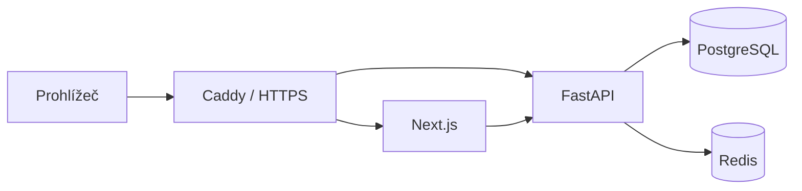

# Architektura

Monorepo spravuje JavaScript závislosti přes pnpm a Python prostředí přes uv.
Turborepo spouští kontroly a build aplikací. Verze a přípravu prostředí
popisuje [vývojový návod](development.md).

## Aplikace a sdílené části

| Cesta | Odpovědnost |
| --- | --- |
| `apps/web/src/app/` | Next.js App Router, stránky a layouty |
| `apps/web/src/core/` | Autentizace, sdílené UI, nastavení vzhledu a poskytovatelé |
| `apps/api/server/core/` | Účty, relace, oprávnění, audit a společné databázové operace |
| `apps/api/server/modules/` | Škola, učebny, rozvrh a třídnice |
| `packages/api-client/` | Generované TypeScript typy a SDK |
| `packages/config-typescript/` | Sdílená konfigurace TypeScriptu |

Backendové moduly sdílejí infrastrukturu z `core`. Jejich konkrétní tabulky,
služby a operace popisuje [README API](../apps/api/README.md); každý modul
nemá stejnou sadu souborů. Frontend používá sdílené komponenty z `core`
a routy z `app`. Samostatná doménová modulová vrstva v této větvi ještě není
implementovaná.

## API kontrakt a autentizace

FastAPI exportuje jediný verzovaný snapshot
[`apps/api/schema/openapi.json`](../apps/api/schema/openapi.json).
Z něj vzniká klient `@bod/api-client`; jeho generované zdroje nejsou verzované
a ručně se neupravují. Obnovení klienta popisuje [vývoj](development.md#api-klient).

Prohlížeč volá `/api/` na stejné doméně jako web. Ve vývoji požadavky
přeposílá Next.js, v produkci Caddy. Aplikační instance `apiClient` v
`apps/web/src/core/api/client.ts` zachovává hlavičky, tělo požadavku a cookies,
vypíná HTTP cache a přidává hlavičku pro zápisy. Volání SDK ji předávají
explicitně přes `client: apiClient`; nastavení nezávisí na importu autentizace.
Serverové vykreslení předává interní URL a cookie v konkrétním volání,
nikoli změnou globální konfigurace klienta.

`apiData` a `apiVoid` z `core/api/result.ts` převádějí výsledek SDK na data
nebo chybu s HTTP statusem a kódem backendu. Parser zachovává zprávu serveru
a validační lokace; síťové chyby obsahují původní příčinu. Zrušený požadavek
si ponechá původní důvod zrušení. Globální obsluha odhlášení rozlišuje
neplatné přihlášení od nesprávného hesla při konkrétní operaci.
Relace a jejich expirace jsou uložené v PostgreSQL. Redis slouží limiteru
přihlašování.

## Relace v prohlížeči

Auth store drží jeden uživatelský snapshot a verzi přihlášení. Verze odlišuje
staré odpovědi i při opětovném přihlášení stejného účtu. Síťové operace jsou
v `core/auth/api.ts` a řízení přechodů v `core/auth/session.ts`.

Přihlášení, odhlášení a změna role ruší běžící dotazy, vymažou klientskou
cache a obnoví serverové vykreslení. Výpadek sítě ponechá posledního ověřeného
uživatele. Hromadné odhlášení zařízení určuje aktuální relaci ze serveru,
ruší ji jako poslední a po částečném neúspěchu obnoví skutečný seznam.

## Provoz

Databáze, Redis a API mají v distribučním balíčku pouze interní síť.
Trvalé volumes uchovávají databázi, školní média a stav Caddy.
API při startu provádí verzované migrace; `create_all` samo neumí měnit
existující sloupce. Pravidla doménových migrací jsou v README API.

Zdrojový Compose je v `infra/docker-compose.yml`. Vývojové databáze používají
`docker-compose.dev.yml`, lokální produkční ověření doplňuje
`docker-compose.verify.yml`. Distribuční balíček vzniká ze zdrojového Compose;
úplné zálohy a aktualizace spravuje instalátor z `infra/deploy/`.
Postup a provozní omezení popisuje [nasazení](deployment.md).
