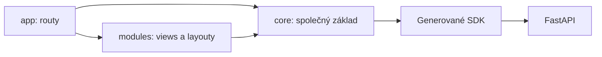

# Architektura

bod je monorepo s odděleným webem a API. pnpm a uv spravují závislosti,
Turborepo spouští kontroly a build. Verze prostředí určuje
[vývojový návod](development.md).

## Struktura

| Cesta | Odpovědnost |
| --- | --- |
| `apps/web/src/app` | URL, serverové hranice a předání view nebo layoutu |
| `apps/web/src/core` | API klient, autentizace, společné UI a shell aplikace |
| `apps/web/src/modules` | Konkrétní obrazovky, jejich uspořádání a stav |
| `apps/api/server/core` | Účty, relace, oprávnění, audit a databázová infrastruktura |
| `apps/api/server/modules` | Škola, učebny, rozvrh a třídnice |
| `packages/api-client` | Generované TypeScript typy a SDK |
| `packages/config-typescript` | Sdílená konfigurace TypeScriptu |
| `tests` | Testy API, webu, prohlížeče a nasazení |
| `infra` | Služby, instalátor a metadata vydání |
| `scripts` | Kontrola závislostí a sestavení distribučního balíčku |
| `.github` | CI, vydávání a pravidla spolupráce |

## Frontend

`core` neimportuje moduly. Obecné UI nezná autentizaci, API ani nastavení
aplikace. Tyto hranice hlídá
[test závislostí](../tests/web/frontend-boundaries.test.ts).

| Co upravuješ | Kam to patří |
| --- | --- |
| Tlačítko, pole, nadpis, sekci nebo dialog | `core/ui` |
| Globální layout, sidebar a mobilní navigaci | `core/shell` |
| Přihlášení a životní cyklus relace | `core/auth` |
| Komunikaci s API a zpracování chyb | `core/api` |
| Uložené preference vzhledu | `core/appearance` |
| Konkrétní obrazovku a její uspořádání | `modules/<agenda>/views` |
| Layout a navigaci jedné agendy | `modules/<agenda>/layout` |
| Stav, dotazy a operace agendy | `modules/<agenda>/hooks` |
| Ucelenou část obrazovky | `modules/<agenda>/components` |

Složka vzniká až s obsahem. Routa předává view nebo layout; klientské
formuláře a datová logika patří do modulu. Například přihlášení má view
v `modules/auth`, společné řízení relace zůstává v `core/auth`.

Moduly skládají `Page`, `PageHeader`, `Section`, `Field` a další primitiva.
Nevytvářejí jejich kopie podle názvu obrazovky. Tokeny, styly a exporty
popisuje [vizuální identita a UI](design-system.md).

## Data a stav

PostgreSQL je zdroj dat. TanStack Query drží klientskou cache serverových dat.
Zustand drží snapshot přihlášení a preference. Stav formuláře patří
k příslušné obrazovce.

Po zápisu se obnoví související dotazy. Změna účtu nebo role zruší běžící
dotazy a vyčistí cache. Verze přihlášení brání tomu, aby pozdní odpověď
obnovila data předchozího účtu. Výpadek sítě ponechá posledního ověřeného uživatele.

## API a relace

Autoritativní kontrakt je
[`apps/api/schema/openapi.json`](../apps/api/schema/openapi.json).
Z něj vzniká `@bod/api-client`. Generované zdroje se neverzují ani ručně
neupravují. Postup obnovení je ve [vývojovém návodu](development.md#api-klient).

Volání SDK předávají `apiClient` explicitně. Klient zachovává cookies,
vypíná HTTP cache a přidává hlavičku pro zápisy. `apiData` a `apiVoid`
převádějí výsledek na data nebo chybu se statusem a kódem backendu.
Síťové chyby a zrušené požadavky si ponechají původní příčinu.

Prohlížeč volá `/api/` na stejné doméně. Ve vývoji požadavky předává Next.js,
v produkci Caddy. Serverové vykreslení předává interní URL a cookie
v konkrétním volání, bez změny globálního klienta.

Relace jsou v PostgreSQL. Redis omezuje pokusy o přihlášení. Frontend
rozlišuje neplatnou relaci od nesprávného hesla při konkrétní operaci.
Hromadné odhlášení ruší aktuální zařízení jako poslední; po částečném
neúspěchu načte skutečný seznam zbývajících relací.

## Backend a provoz

Backendové moduly sdílejí infrastrukturu z `core`. Doménový model,
endpointy a migrace popisuje [README API](../apps/api/README.md).

Školní server používá hotový balíček s Caddy, webem, API, PostgreSQL a Redisem.
Databáze, Redis a samostatné API zůstávají v interní síti. Trvalá data,
aktualizace a obnovu popisuje [nasazení](deployment.md).
