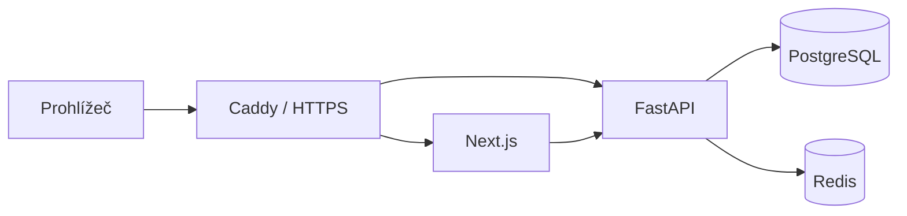

# Architektura

Monorepo spravuje JavaScript závislosti přes pnpm a Python prostředí přes uv.
Turborepo spouští kontroly a build aplikací. Verze a přípravu prostředí
popisuje [vývojový návod](development.md).

## Aplikace a sdílené části

| Cesta | Odpovědnost |
| --- | --- |
| `apps/web/src/app/` | Next.js App Router, stránky a layouty |
| `apps/web/src/core/` | Autentizace, sdílené UI, nastavení vzhledu a poskytovatelé |
| `apps/api/server/core/` | Účty, relace, oprávnění, audit a společné databázové operace |
| `apps/api/server/modules/` | Škola, učebny, rozvrh a třídnice |
| `packages/api-client/` | Generované TypeScript typy a SDK |
| `packages/config-typescript/` | Sdílená konfigurace TypeScriptu |

Backendové moduly sdílejí infrastrukturu z `core`. Jejich konkrétní tabulky,
služby a operace popisuje [README API](../apps/api/README.md); každý modul
nemá stejnou sadu souborů. Frontend používá sdílené komponenty z `core`
a routy z `app`. Samostatná doménová modulová vrstva v této větvi ještě není
implementovaná.

## API kontrakt a autentizace

FastAPI exportuje jediný verzovaný snapshot
[`apps/api/schema/openapi.json`](../apps/api/schema/openapi.json).
Z něj vzniká klient `@bod/api-client`; jeho generované zdroje nejsou verzované
a ručně se neupravují. Obnovení klienta popisuje [vývoj](development.md#api-klient).

Prohlížeč volá `/api/` na stejné doméně jako web. Ve vývoji požadavky
přeposílá Next.js, v produkci Caddy. Společný transport autentizace zachovává
hlavičky a session cookie při volání generovaného SDK; serverové vykreslení
předává cookie backendu. Relace a jejich expirace jsou uložené v PostgreSQL.
Redis slouží limiteru přihlašování.

## Provoz

Databáze, Redis a API mají v distribučním balíčku pouze interní síť.
Trvalé volumes uchovávají databázi, školní média a stav Caddy.
API při startu provádí verzované migrace; `create_all` samo neumí měnit
existující sloupce. Pravidla doménových migrací jsou v README API.

Zdrojový Compose je v `infra/docker-compose.yml`. Vývojové databáze používají
`docker-compose.dev.yml`, lokální produkční ověření doplňuje
`docker-compose.verify.yml`. Distribuční balíček vzniká ze zdrojového Compose;
úplné zálohy a aktualizace spravuje instalátor z `infra/deploy/`.
Postup a provozní omezení popisuje [nasazení](deployment.md).
